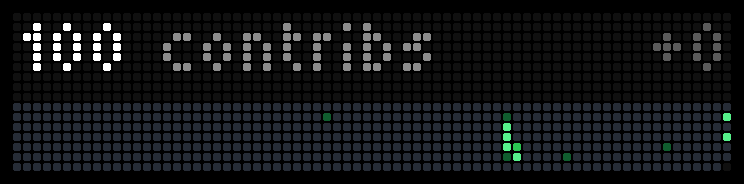

# GitHub Activity

Your GitHub contribution graph on the front screen of a [BUSY Bar](https://busy.bar).



The top line shows how many contributions you made in the last year, the same number your GitHub
profile shows, and on the right how many you made today. Below is the contribution graph, drawn the
way GitHub draws it: one column per week, one row per weekday with Sunday on top, and the current
week on the right edge. The 72 columns cover the last 72 weeks, about 16 months.

The bar reads the data over its own Wi-Fi connection. No computer, script or GitHub token is involved.

## Install

You need a BUSY Bar on firmware **1.3.1 or newer**, connected to Wi-Fi.

1. Download `app.avachadev.ghactivity.tgz` from the
   [latest release](https://github.com/avachadev/busybar-github-activity/releases/latest).
2. Open the bar's web interface: `http://10.0.4.20` when the bar is plugged in by USB, or the bar's IP
   address on Wi-Fi. Go to **Apps → Add app** and pick the file.
3. In **Apps → GitHub Activity**, paste your profile link into **GitHub profile** and save.

The graph appears on the bar within about 15 seconds. The first time, the last year comes first and
the older weeks fill in from the left a few seconds later.

## Settings

| Setting | What it does |
| --- | --- |
| **GitHub profile** | Whose activity to show. A link such as `https://github.com/octocat` works, and so do `github.com/octocat`, `@octocat` and just `octocat`. The profile must be public. |

A changed profile shows up within a few seconds, without restarting the app. A short press of
**Back** quits the app. Start it again from the bar's Apps menu or with **Start** in the web interface.

## What the bar shows

| Screen | Meaning |
| --- | --- |
| `1234 contribs +12` and the graph | Contributions in the last year, contributions today, and the graph. `+0` is dimmed on a quiet day. When the total and today's count get too long to fit, the `contribs` label is dropped. |
| `SET PROFILE` / `IN SETTINGS` | No profile set yet. |
| `BAD PROFILE` and what you typed | Not a GitHub user name or profile link. |
| `LOADING` and the user name | The first read, about 10 seconds. |
| `NOT FOUND` and the user name | GitHub has no such user. Check the spelling in the settings. |
| `NO DATA` and the user name | The bar could not read the data: no internet, or the data service is down. The app keeps retrying, waiting a little longer each time. |

Once a graph is on screen it stays there if a later refresh fails. The data is refreshed every 15
minutes. The app also remembers the last graph, so it opens on it immediately next time and only has
to fetch the last year again.

## Where the data comes from

GitHub has no API for the contribution graph that works without a token. The graph exists only as a
220 KB HTML page, more memory than a bar app has. So the app reads it through
[github-contributions-api](https://github.com/grubersjoe/github-contributions-api), a free open-source
service that turns that page into compact JSON:

```
https://github-contributions-api.jogruber.de/v4/<user>?y=last
```

Each refresh is one request of about 15 KB. The first time a profile is shown there is one more
request, for the weeks before the last year. The service sees only the public user name, and it
caches answers for about an hour, so today's count can lag behind GitHub by that much.

The numbers are GitHub's **contributions**, not just commits: commits, pull requests, issues and code
reviews all count, the same as on your profile. They include private contributions only if you turned
on **Include private contributions on my profile** in your GitHub settings.

## How the screen is drawn

The text line is on rows 1–5 in the bar's `small` font, 1 px from the left and right edges. The graph
is a single 72×7 `xpmbitmap` on rows 9–15, one pixel per day. Days after today in the current week are
transparent, as on GitHub. The greens are a little brighter than GitHub's dark theme because the
darkest of those barely light up on LEDs.

| | Colour |
| --- | --- |
| No contributions (level 0) | `#262c36` |
| Level 1 | `#0e5c2e` |
| Level 2 | `#108f3e` |
| Level 3 | `#2bc653` |
| Level 4, and today's count | `#56f08a` |
| Total | `#ffffff` |
| `contribs` label | `#8b8b8b` |
| `+0` | `#5a5a5a` |

The levels are GitHub's own: it splits each user's days into quartiles, so a level is relative to that
user's busiest days.

## Development

Requires Node 24 (Node 26 is not supported).

```bash
npm install
npm run typecheck
npm test
npm run build                                  # dist/app.avachadev.ghactivity.tgz
npm run app:install                            # install on the bar connected over USB
npm run app:run
```

Over Wi-Fi add `-- --addr <bar-ip>` (and `--password <password>` if the bar has one). Do not pass
`--addr` to `npm run build`: it changes the address the app itself talks to, which must stay `localhost`.

| Path | What it is |
| --- | --- |
| `src/main.ts` | Entry point: settings polling, refreshes, redrawing, the **Back** button. |
| `src/profile.ts` | Turns a pasted link or name into a GitHub user name. |
| `src/config.ts` | Reads the setting. |
| `src/contributions.ts` | Reads and parses the calendar, and merges the last year with the older weeks. |
| `src/cache.ts` | Keeps the last complete graph in `localStorage`. |
| `src/heatmap.ts` | Renders the graph as XPM2. |
| `src/screen.ts` | Display elements for the graph and the message screens. |
| `src/layout.ts` | Screen geometry, palette and text widths. |
| `src/appmeta/` | Manifest, settings schema, icons. |
| `test/` | Unit tests, run with Node's built-in test runner. |

Releases are built by GitHub Actions: push a tag equal to the version in `src/appmeta/manifest.json`
(e.g. `1.0.0`) and the workflow attaches `app.avachadev.ghactivity.tgz` to the release.

## License

[MIT](LICENSE). GitHub is a trademark of GitHub, Inc. This app is not affiliated with GitHub.
