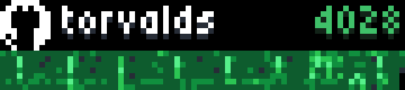
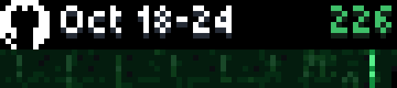
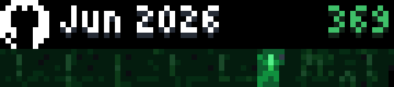
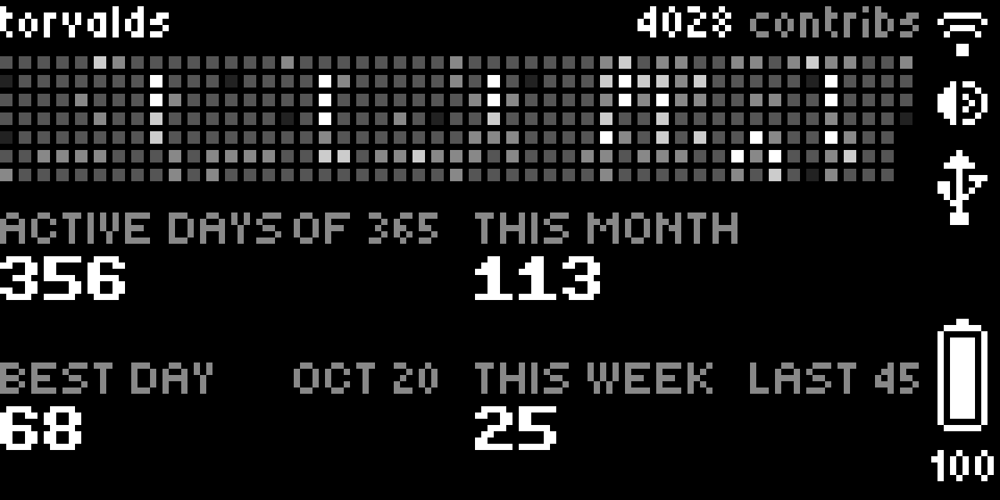

<!-- Made by BUSY Bar Emulator from catalog.json. Edit it freely: once you change it, it is yours and is not made again. -->

# GitHub Activity

Your GitHub contributions on the BUSY Bar. Press **Start** or **OK** to switch between day, week, month and year; turn the Scroll Wheel to go back in time. The back screen shows your stats.






## How to use

- **Start**: Switches between profile, day, week, month and year
- **Wheel turn**: Goes back in time, one period per click, and forward again
- **Wheel press**: Same as Start
- **Back**: Returns to the current period; from there, closes the app

The graph lights the period you are looking at and dims the rest. Before the first use, open the bar's web interface, go to Apps, GitHub Activity, and paste your GitHub profile link or user name. The profile must be public.

## Settings

Change them in the BUSY Bar's local web interface.

- **GitHub profile**: Link to a GitHub profile, e.g. https://github.com/octocat, or just the user name. The profile must be public.

## Build and install

```sh
npm ci
npm run build         # dist/app.avachadev.ghactivity.tgz
npm run app:install   # on a BUSY Bar connected over USB
```

Or open the folder in BUSY Bar Emulator and press Refresh.

## Where the data comes from

The bar reads your public contribution graph over its own Wi-Fi through the open-source
[github-contributions-api](https://github.com/grubersjoe/github-contributions-api), which sees only the
user name and caches answers for about an hour. No GitHub token is needed. Contributions are commits,
pull requests, issues and code reviews, as on your profile; private ones count only if your profile
shows them.

## License

MIT: see [LICENSE](LICENSE). GitHub is a trademark of GitHub, Inc. This app is not affiliated with GitHub.

Made for [BUSY Bar](https://busy.app).
